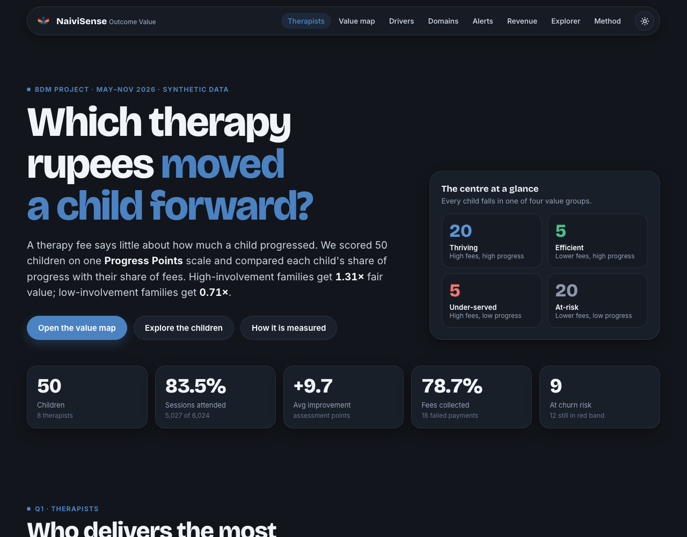
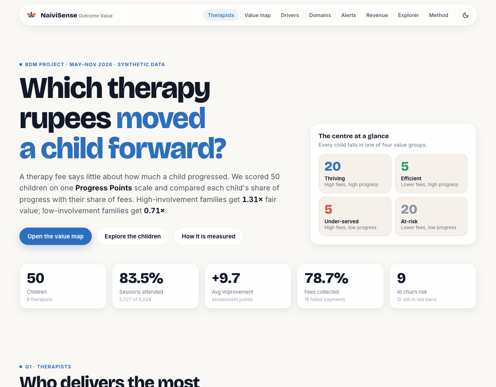
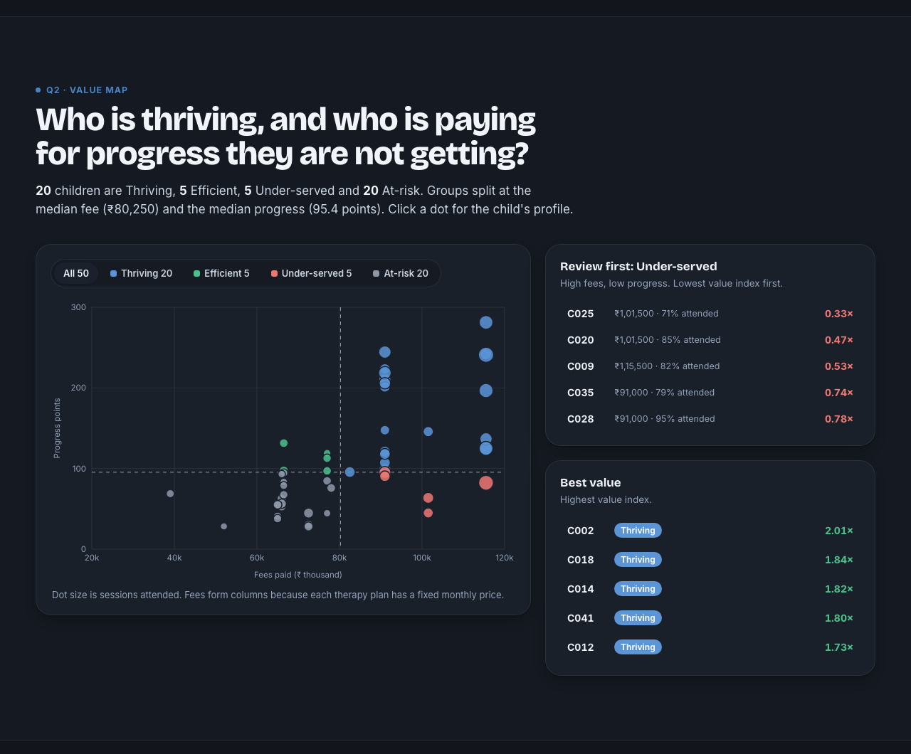

# NaiviSense Outcome Value: which therapy spend earned its price?

**Live dashboard: [https://naivisense-bdm.netlify.app](https://naivisense-bdm.netlify.app)** · [Slides (PDF)](https://naivisense-bdm.netlify.app/downloads/NaiviSense_Outcome_Value_Slides.pdf)

A BDM (Business Data Management) analytics project built on the NaiviSense therapy-centre data model. It scores every child on one **Progress Points** scale and compares each child's share of centre progress with their share of centre fees: the **Outcome Value Index** (1.00 = fair value).

It ships as an interactive web dashboard, a Power BI project, a written report and a presentation script, all built on one dataset. **All data are synthetic** (50 children, 8 therapists, 4 May – 15 Nov 2026). Children are identified by code (`C001`–`C050`) only.

| Dark | Light |
|---|---|
|  |  |



## The idea

```
Progress Points      = 10 × assessment gain + 20 × session-score gain + 5 × goals completed   (floor 0)
Outcome Value Index  = (child progress ÷ centre progress) ÷ (child fees ÷ centre fees)
```

Above 1.00 a family received more progress than the fees paid; below 1.00, less. Children are grouped at the median fee and median progress: **Thriving**, **Efficient**, **Under-served**, **At-risk**.

## Six business questions

| # | Question | Finding (synthetic data) |
|---|---|---|
| 1 | Which therapist gives the most progress per rupee? | Kavya Iyer leads at 1.19×, Amit Joshi trails at 0.88×; therapy types sit within 0.96–1.05 |
| 2 | Who is Thriving, Efficient, Under-served, At-risk? | 20 / 5 / 5 / 20 children; 9 children at churn risk |
| 3 | Do attendance or parent involvement drive progress? | High-involvement families get 1.31× fair value, low 0.71×; attendance vs improvement r = +0.46; monthly fee vs improvement r = +0.23 |
| 4 | Which domains improve fastest? | Visual perception (+13.1) and attention (+11.4); slowest emotional regulation (+8.5) |
| 5 | Are safety alerts handled in time? | High severity acknowledged in 1.6 h (all within 4 h); medium/low take about 16 h |
| 6 | Where does revenue leak? | ₹32.95 L collected of ₹41.89 L billed (78.7%); 18 failed payments; not concentrated in low-involvement families |

These patterns were designed into the generator, so they demonstrate the method rather than describe a real centre.

## Repository layout

```
naivisense-bdm/
├── web/                 Interactive dashboard (Vite + React 18 + TypeScript, no chart library). Live on Netlify.
├── netlify.toml         Netlify build settings (base = web); web/vercel.json is the Vercel equivalent
├── 01_Data/
│   ├── raw/             13 collections exactly as the app stores them (CSV)
│   └── processed/       13 star-schema tables (CSV); also written to MongoDB as proc_*
├── 02_PowerBI/          Power BI Project (.pbip): TMDL model, 53 DAX measures, 11-page report, DAX_Measures.md
├── 03_Report/           Written BDM report (.docx) and its figures
├── 04_Presentation/     Slide deck (11 slides, PDF) and timed 10-minute presentation script (PDF + Markdown)
├── 06_Code/             Python scripts: analysis (independent recomputation), PBIP / figure / report / script / dashboard-data generators
├── generator/           TypeScript synthetic-data generator and raw → processed transformation (MongoDB models)
└── docs/screenshots/    Images used in this README
```

## Run the dashboard locally

Requires Node 22+.

```bash
cd web
npm ci
npm run dev        # http://localhost:5173
npm run build      # type-check + production build + CSP hash → web/dist
npm run ci         # lint, format check, build
```

The page imports one file, `web/src/data/dashboard.json`, so it needs no backend or database. Append `?theme=dark` or `?theme=light` to force a theme.

## Deploy

The dashboard is a static site (`web/dist`), so any static host works. It is live on Netlify; Vercel is configured as an alternative.

**Netlify** (current): `netlify.toml` sets base `web`, command `npm ci && npm run build`, publish `dist`. Strict security headers come from `web/public/_headers`, with the inline-script hash filled in at build time.

```bash
npx netlify-cli login
cd web && npm ci && npm run build
npx netlify-cli link                       # once: pick the site (or `netlify sites:create`)
npx netlify-cli deploy --prod --dir=dist
```

Or connect this GitHub repo in Netlify (*Add new site → Import an existing project*); the settings are detected from `netlify.toml`.

**Vercel** (alternative): import the repo, set *Root Directory* to `web`; `web/vercel.json` provides the build settings and security headers. The build fails if the inline-script hash in `vercel.json` is out of date (the error prints the new hash to paste in).

## Rebuild the data and every output

```bash
# 1. Generate synthetic data (dry run writes CSV only; --write also seeds MongoDB database naivisense_synthetic)
cd generator && npm install
npx tsx seed-synthetic.ts                                   # CSV into ../01_Data
MONGO_URL="mongodb+srv://…" npx tsx seed-synthetic.ts --write   # also writes MongoDB (see .env.example)

# 2. Analyse, then regenerate the dashboard data, Power BI project, figures, report and script
cd ../06_Code
python3 analysis.py            # recomputes every number -> results.json
python3 export_dashboard.py    # -> ../web/src/data/dashboard.json
python3 build_pbip.py          # -> ../02_PowerBI
python3 make_figures.py && python3 make_report.py && python3 make_script.py   # need matplotlib + python-docx
python3 make_slides.py         # slide deck PDF (needs Google Chrome; set CHROME=… to override the path)
```

The generator is deterministic (values and ObjectIds): two runs produce identical files. The seeder only deletes documents tagged `synthetic: true` and refuses to write to a database named `naivisense` unless `--allow-app-db` is passed.

## Power BI

Open `02_PowerBI/NaiviSense_Outcome_Value.pbip` in Power BI Desktop (Windows), set the `DataFolder` parameter to the absolute path of `01_Data`, and check the **QA Checks** page against the expected values in each card's label. See `02_PowerBI/README_Open_In_PowerBI.md` and `02_PowerBI/DAX_Measures.md`.

## What has and has not been verified

Verified:
- Every number in the dashboard, report and script is recomputed by `06_Code/analysis.py` from the processed CSVs; the centre-wide value index is exactly 1.000.
- Two generator runs are byte-identical; the generator compiles under `tsc --strict`.
- The dashboard type-checks, lints, builds from a clean `npm ci`, renders in light and dark themes and at narrow width, and works under its Content-Security-Policy. The deployed site was checked for the security headers, the downloads and rendered content.

Not verified:
- The `.pbip` has **not** been opened in Power BI Desktop (Windows-only; built on a Mac). The DAX and report JSON are unevaluated by Power BI.
- The NaiviSense backend test suite (`npm test`) did not finish on the build machine, so no result is claimed.
- The Word report's layout was not visually inspected; its cover has placeholders for student names and no dashboard screenshots yet.

## Limitations

- Synthetic data with designed relationships; findings are illustrative.
- The Progress Points weights (10, 20, 5) are a modelling choice that should be agreed with clinicians.
- Therapist attribution is proportional to attended sessions, not causal; small groups (for example Cerebral Palsy, 2 children) are unreliable.
- Seven months of data, with November a part month.

## Privacy

The processed layer, dashboard, exports and Power BI project carry no child names, only codes, and no password hashes. For real data, also pseudonymise parent contact details and apply row-level security before sharing a report, because the data describe children's health.

## Credits

Structure and the value-index idea follow the *IPL Auction Valuation and Player Performance Intelligence* BDM project. The visual language (warm paper palette, Inter and Bricolage Grotesque, glass navigation) follows the NaiviSense landing page; the fonts are self-hosted under the SIL Open Font License (`web/public/fonts/OFL.txt`).
